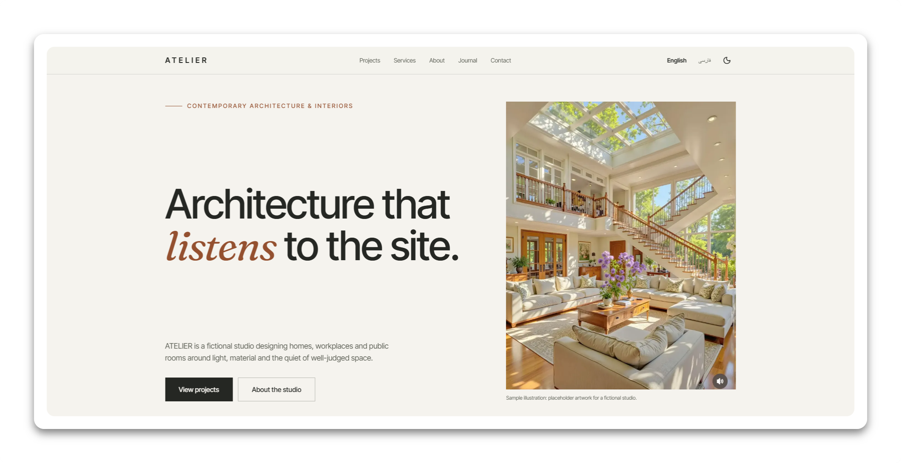
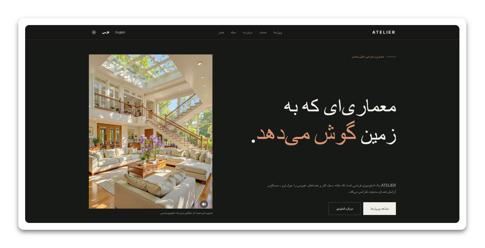
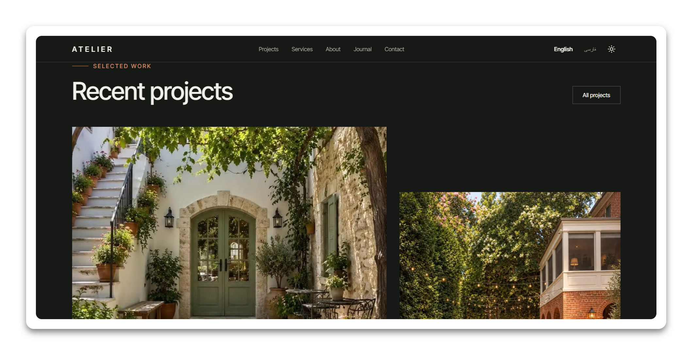
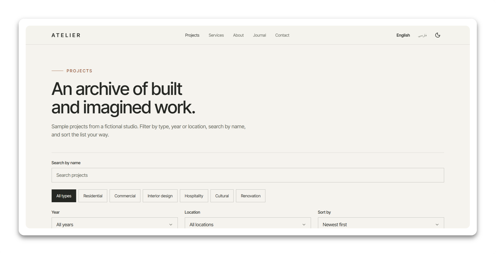
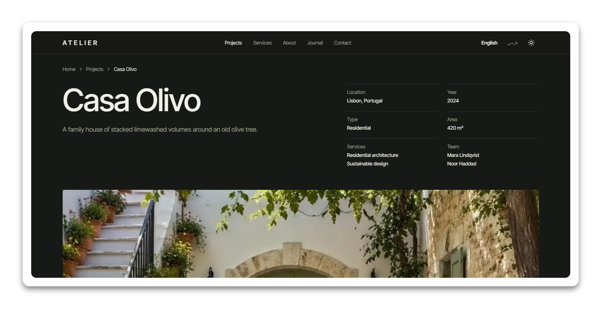
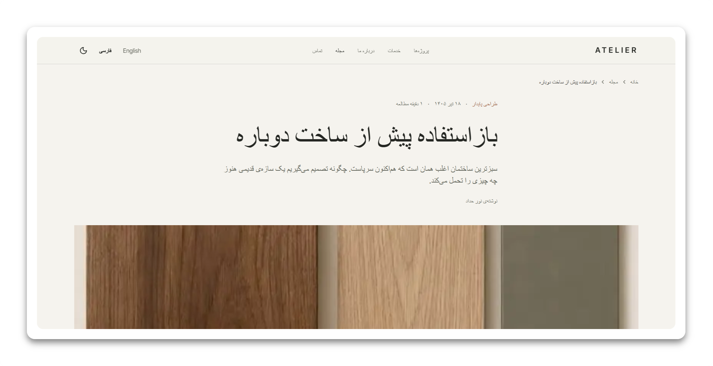
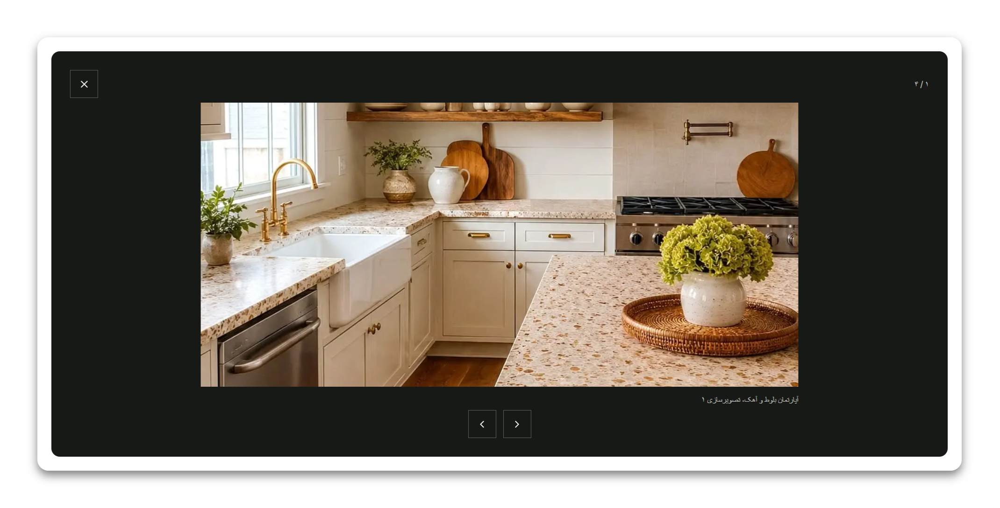
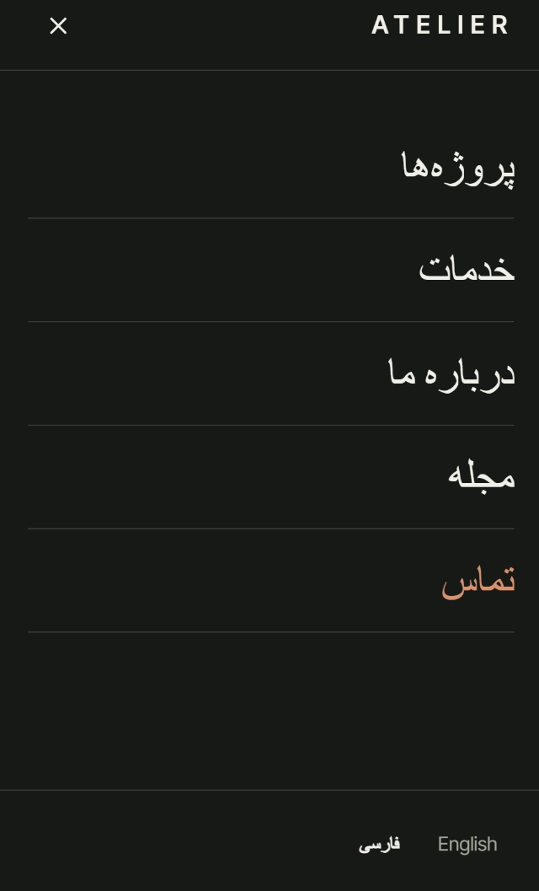
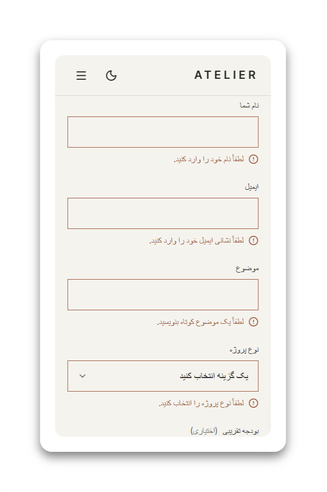

# ATELIER — Architecture & Living

A bilingual (English / Persian, LTR / RTL) portfolio website for a **fictional** contemporary architecture
studio, built as a frontend engineering showcase: Next.js App Router, strict TypeScript, a custom design
system, real filtering and search, an accessible gallery, and an automated test suite that runs in a real
browser.

> **This is a demo.** ATELIER, its projects, people, articles and contact details are invented. The contact
> form sends nothing. All artwork is generated placeholder illustration, not photography.
> See [Demo limitations](#demo-limitations).



|                                                             |                                                              |
| ----------------------------------------------------------- | ------------------------------------------------------------ |
|    |  |
|   |        |
|  |            |

Mobile: Persian menu and form validation (right-to-left, dark and light).

 

## Features

- **Two languages, two directions.** `/en` and `/fa` for every page, a language switcher that keeps you on the
  equivalent page _and_ its query string, translated metadata, locale-aware numbers and dates (Persian digits,
  Persian calendar), and logical CSS so RTL is a property of the layout, not a second copy of it.
- **Light and dark themes**, both designed (not inverted), with no flash on load, the saved choice remembered,
  and the system preference respected on a first visit.
- **Projects archive** with type, year and location filters, name search (works across languages), sorting,
  result count, empty state, and filter state kept in the URL so a filtered view can be shared.
- **Project pages** with facts, concept, materials, challenge and solution, a keyboard-operable lightbox,
  related projects and breadcrumbs.
- **Journal** with featured articles, search, categories, locale-formatted dates, reading time and related
  articles.
- **Services, About, Contact, Privacy, Terms**, and a designed 404.
- **Contact form** with Zod validation, translated error messages, focus management, loading/success/error
  states and double-submit protection. It is wired to a replaceable demo service.
- **Accessibility** targeted at WCAG 2.2 AA: semantic HTML, skip link, visible focus, labelled controls,
  native `<dialog>` for the menu and lightbox, reduced-motion support, and automated axe audits in CI.
- **SEO**: per-page metadata, canonical and hreflang alternates, `sitemap.xml`, `robots.txt`, and structured
  data limited to what is true of the content (breadcrumbs, articles).

## Tech stack

| Area          | Choice                                                                     |
| ------------- | -------------------------------------------------------------------------- |
| Framework     | Next.js 16 (App Router), React 19                                          |
| Language      | TypeScript 6, `strict` plus `noUncheckedIndexedAccess`                     |
| Styling       | Tailwind CSS 4 with CSS-variable design tokens, `class-variance-authority` |
| i18n          | `next-intl` 4 (typed messages, locale routing through `proxy.ts`)          |
| Forms         | React Hook Form + Zod 4                                                    |
| Icons / fonts | `lucide-react`; Inter Tight, Fraunces and Vazirmatn, self-hosted (OFL)     |
| Unit tests    | Vitest + React Testing Library (jsdom)                                     |
| Browser tests | Playwright + `@axe-core/playwright`                                        |
| Quality       | ESLint 9 (flat config), Prettier, Conventional Commits                     |

Libraries often assumed for a project like this that are deliberately **not** used (no real need): shadcn/ui,
Zustand, TanStack Query, Embla Carousel and Motion. See [technical decisions](docs/technical-decisions.md).

## Getting started

Requirements: **Node.js 20.9 or newer** and npm.

```bash
npm install
cp .env.example .env.local   # then set NEXT_PUBLIC_SITE_URL, see below
npm run dev                  # http://localhost:3000, redirects to /en
```

Production build:

```bash
npm run build
npm run start
```

### Environment variables

| Variable               | Purpose                                                                                                                                                                                                                                                               |
| ---------------------- | --------------------------------------------------------------------------------------------------------------------------------------------------------------------------------------------------------------------------------------------------------------------- |
| `NEXT_PUBLIC_SITE_URL` | Public origin (for example `https://example.com`). Used for canonical URLs, hreflang alternates, the sitemap and structured data. Set it at **build time**; with a wrong value, search tools flag the canonical link as invalid. Defaults to `http://localhost:3000`. |

## Scripts

| Script                     | What it does                                                                 |
| -------------------------- | ---------------------------------------------------------------------------- |
| `npm run dev`              | Development server                                                           |
| `npm run build` / `start`  | Production build and server                                                  |
| `npm run lint`             | ESLint                                                                       |
| `npm run typecheck`        | `tsc --noEmit` (run it after a build; it reads Next's generated route types) |
| `npm test`                 | Unit and component tests (Vitest)                                            |
| `npm run test:watch`       | Vitest in watch mode                                                         |
| `npm run test:e2e`         | Browser tests (Playwright). Builds and starts the site itself                |
| `npm run check:bundle`     | Fails if any page's first-load JavaScript exceeds its budget                 |
| `npm run docs:screenshots` | Regenerates the screenshots above from a running build                       |
| `npm run format`           | Prettier                                                                     |

### Running the tests

```bash
npm test                       # 200+ unit and component tests, a few seconds
npx playwright install chromium  # once
npm run test:e2e               # 170+ browser tests, a few minutes
```

The browser suite covers the full visitor journey in English and Persian, filters and URL state, the
lightbox and contact form with the keyboard only, theme behaviour (including "no flash with every script
blocked"), real 404 pages (including their theme), a check that every page loads with a completely quiet
console and no leaked translation keys, a no-horizontal-scroll check across 10 pages, 2 languages and 5
widths, reduced-motion behaviour, a link crawler, and axe accessibility audits for every page in both languages and
both themes plus the open menu, lightbox, form errors and filter panel.

If you cannot download Playwright's browsers (for example in a restricted network), point it at an existing
Chromium: `CHROMIUM_PATH=/path/to/chromium npm run test:e2e`.

## Project structure

```
src/
├── app/
│   ├── [locale]/            Pages: home, projects, services, about, journal, contact, privacy, terms, 404
│   ├── art/[file]/          Build-time generated placeholder artwork (SVG files)
│   ├── sitemap.ts, robots.ts, icon.svg
│   └── globals.css          Design tokens (colours, type scale, motion) and base styles
├── components/
│   ├── ui/                  Button, Link, Container, Breadcrumb, Lightbox
│   ├── shared/              SectionHeading, Section, CtaBand, ArtImage, LegalDocument, JsonLd
│   ├── layout/              Header (with mobile menu), Footer, Logo
│   ├── forms/               Field, TextInput, Select, Textarea, ContactForm
│   ├── home/, projects/, services/, about/, journal/   Page sections and cards
├── features/                Logic grouped by feature: localization, theme, projects, journal, contact
├── data/                    Typed, bilingual sample content (projects, details, services, articles)
├── messages/                en.json, fa.json (interface text, type-checked)
├── i18n/                    Routing, navigation helpers, request config
├── lib/                     cn(), theme script, SEO helpers, artwork generator, structured data
├── services/                contact.ts, the swappable demo submission service
└── types/                   Content types and the next-intl type augmentation
tests/e2e/                   Playwright specs
scripts/                     Bundle budget check, screenshot generator
docs/                        Technical decisions, screenshots
```

## Common tasks

### Add a project

1. Add an entry to `src/data/projects.ts`: a unique URL-safe `slug`, `category`, `year`, a two-letter ISO
   `country` code, `featured`, and `title`, `location` and `summary` in both languages.
2. Add the matching entry to `src/data/project-details.ts` (same slug): concept, approach, materials,
   challenge, solution, services, team and gallery, again in both languages.
3. Run `npm test`. The data tests fail if a slug is duplicated, a translation is missing, or a project has no
   details. Pages, filters, sitemap and static routes pick the project up automatically.

To use real photography, put the files under `public/` and set `image.src` (and `src` on gallery items). The
placeholder artwork is then ignored and `next/image` takes over. Give every image a meaningful `alt` in the
data or messages before publishing.

### Add a journal article

Add it to `src/data/articles.ts`. Bodies are lists of `heading` / `paragraph` blocks; a test requires that both
languages have the same block structure. Reading time and the formatted date are derived automatically.

### Add or change interface text

Edit **both** `src/messages/en.json` and `src/messages/fa.json`. Keys are type-checked (a typo is a compile
error) and a test fails if the two files differ in keys or ICU placeholders. A client component can only use
a namespace listed in `CLIENT_NAMESPACES` in `src/app/[locale]/layout.tsx`, which keeps the JavaScript sent
to the browser small. A test fails if client code uses a namespace that is not listed (the list now lives in
`src/i18n/client-namespaces.ts`).

### Add a language

Add the locale to `src/i18n/routing.ts` and `src/features/localization/locales.ts` (name and direction),
create `src/messages/<locale>.json`, and add its text to the data files. TypeScript points out every place
that still needs it.

### Extend the design system

Colours, the type scale and motion tokens live in `src/app/globals.css`. Light and dark values are defined
side by side; text colours were checked against WCAG contrast ratios (the comments in the file record why the
original olive and brick needed darker "ink" variants for text). Components use `class-variance-authority`
variants (see `components/ui/button.tsx`) and `cn()`, which is configured to understand the custom
`text-display` and `text-headline` sizes.

### Replace the demo contact service

`src/services/contact.ts` exports `submitContactRequest`. Replace its body with a `fetch` to your endpoint and
keep the `ContactResult` return type; the form needs nothing else. Until then, an address ending in
`@error.example` triggers the error state so it can be demonstrated.

## Quality results

Measured on the production build. Lighthouse used its mobile profile (simulated 4× CPU slowdown and slow 4G),
so absolute numbers are pessimistic; run it yourself on your hardware.

| Page             | Performance | Accessibility | Best practices | SEO | TBT    | CLS |
| ---------------- | ----------- | ------------- | -------------- | --- | ------ | --- |
| Home             | 95          | 100           | 100            | 100 | 250 ms | 0   |
| Project detail   | 97          | 100           | 100            | 100 | 150 ms | 0   |
| Article          | 95          | 100           | 100            | 100 | 170 ms | 0   |
| Journal          | 95          | 100           | 100            | 100 | 250 ms | 0   |
| Projects archive | 88          | 100           | 100            | 100 | 250 ms | 0   |

Scores vary between runs (Total Blocking Time most of all), so use several runs before comparing. Mobile LCP
on the archive page is still above 2.5 s in this simulation; the image itself loads in about 40 ms and the
rest is hydration work. `npm run check:bundle` keeps first-load JavaScript within budget: about 165-175 KB
gzip per page (about 207 KB for the contact page, which ships the form libraries), of which roughly 115 KB is
React and the Next.js runtime. Legacy-browser polyfills carry `nomodule` and are not downloaded by modern
browsers, so they are not counted.

## Demo limitations

- **Fictional content.** The studio, projects, people, articles, statistics and contact details are samples,
  and the privacy and terms pages say so. Statistics on the home page are computed from the sample data.
- **Placeholder artwork**, not photography. It is generated by `src/lib/art-svg.ts` and served as cached SVG
  files from `/art/`.
- **The contact form does not send anything.** There is no backend, database or authentication, by design.
  Anything needing one (an admin area, image uploads, real form delivery) is future work.
- **Persian and English copy were written for this demo** and should be reviewed by a native editor before
  any real use.
- **Tested in Chromium only.** Safari and Firefox have not been exercised.
- **404 pages need JavaScript to render their content.** With Next.js 16.4.3 a `notFound()` response carries
  the correct 404 status but an empty shell that the browser fills in; the content, language and direction
  appear after hydration. Real browsers are tested; the raw HTML is not.
- **Needs a Node server.** Locale routing runs in `proxy.ts`, so a pure static export is not possible; deploy
  anywhere that runs `next start` (or a platform with native Next.js support).

## Git workflow

History follows [Conventional Commits](https://www.conventionalcommits.org) (`feat:`, `fix:`, `test:`,
`perf:`, `docs:`, `chore:`), one logical change per commit, with lint, type-check and tests passing at each
step. Bug-fix commits say what was found and how.

## More

- [Technical decisions](docs/technical-decisions.md): why the project is built the way it is.
- Fonts are vendored under `src/assets/fonts` (SIL Open Font License 1.1).
